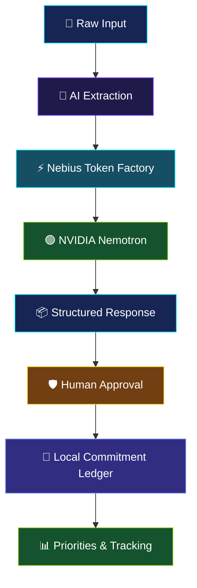

<div align="center">


<br>


<br><br>

[](https://nebius.com)
[](https://build.nvidia.com)
[](https://nebius.ai)
[](LICENSE)

<br>

### 🌐 [LIVE DEMO](https://nebius-nvidia-hackathon-seven.vercel.app) · [💻 SOURCE CODE](https://github.com/Raj-max-pixal/PromiseOs)

</div>

---

## 🎬 Experience PromiseOS

<div align="center">

<!-- Replace this image with your actual application demo GIF -->


**From scattered conversations to structured commitments.**

</div>

> **Note:** Add your actual demonstration GIF at `assets/promiseos-demo.gif`. The image will not appear until that file exists in your repository.

---

## ⚡ What Is PromiseOS?

PromiseOS is an AI-powered commitment management platform that transforms unstructured notes, conversations, and ideas into actionable commitments.

Powered by **NVIDIA Nemotron through Nebius Token Factory**, PromiseOS combines AI extraction, human approval, and a local-first commitment ledger.

Instead of generating another conversation, PromiseOS helps users identify what they promised, determine what needs attention, and track what remains unfinished.

<div align="center">

|       🧠 AI Intelligence      |       🔒 Privacy First      |     🎯 Accountability     |
| :---------------------------: | :-------------------------: | :-----------------------: |
| Extract commitments from text |  Browser-based local ledger | Track tasks and deadlines |
|    Structured AI responses    | Server-side API credentials |   Human-approved actions  |
|   Evidence-backed proposals   |   User-controlled approval  | Risk-aware prioritization |

</div>

---

## ✨ Features in Action

### 🧠 01 — AI Commitment Extraction


Transform ordinary sentences into structured tasks with relevant details, owners, deadlines, and supporting source excerpts.

### 🛡️ 02 — Human Approval Gate


AI-generated proposals are reviewed before being accepted into the commitment ledger.

### 📊 03 — Smart Daily Priorities


Organize commitments around urgency, deadlines, and outstanding responsibilities.

### 🔄 04 — Recurring Commitments


Support recurring obligations and habit-related workflows.

### 🤖 05 — Autonomous Agent Vision


Build toward proactive deadline monitoring, context-aware follow-ups, and user-controlled automation.

> These GIFs are intended as visual placeholders for demonstrations. Replace them with recordings of the corresponding implemented features. Do not present planned capabilities as completed functionality.

---

## 🏗️ System Architecture

<div align="center">



</div>

### Technology Stack

<div align="center">


</div>

---

## 🚀 Quick Start

### Requirements

* Node.js 18 or later
* npm
* Git
* Nebius Token Factory API key for live AI inference

### Installation

```bash
git clone https://github.com/Raj-max-pixal/PromiseOs.git
cd PromiseOs
npm install
npm start
```

Open your browser:

```text
http://localhost:3000
```

Configure the inference credentials using the application's supported settings or the backend's environment configuration.

**Security:** Never commit API keys or secrets to your repository.

---

## 🔐 Privacy & Security

* 📒 Commitment records can be stored in browser `localStorage`.
* 🔑 API credentials should remain on the server.
* 🛡️ Users review extracted commitments before approval.
* 🔍 Source excerpts support verification of AI-generated proposals.
* 🚫 Production deployments should validate inputs, restrict access where necessary, and avoid logging sensitive data.

**Privacy note:** Data sent to a hosted inference provider leaves the browser. Local storage is not encrypted by default.

---

## 🗺️ Development Roadmap

* [x] Core commitment management interface
* [x] AI extraction integration
* [x] Human approval workflow
* [x] Browser-based ledger
* [x] Backend inference proxy
* [ ] Production-grade calendar synchronization
* [ ] Robust multi-user delegation
* [ ] Reliable background agent execution
* [ ] Auditable automated follow-ups
* [ ] Enhanced security and synchronization

Update the checklist to match the actual implementation in the repository.

---

## 🌟 Project Vision

<div align="center">

### A promise should not disappear into a chat history.

**Capture it. Verify it. Track it. Complete it.**

PromiseOS aims to make personal accountability a first-class part of AI-powered productivity.

<br>


</div>

---

## 🤝 Contributing

Contributions, bug reports, and feature suggestions are welcome.

1. Fork the repository.
2. Create a feature branch.
3. Implement and test your changes.
4. Submit a pull request.

## 📄 License

Released under the MIT License. See [`LICENSE`](LICENSE) for details.

---

<div align="center">

### ⚡ PROMISE_OS

**Built by Raj for the Nebius x NVIDIA Global AI Hackathon.**

[🌐 Live Demo](https://nebius-nvidia-hackathon-seven.vercel.app) · [💻 GitHub](https://github.com/Raj-max-pixal/PromiseOs)


</div>
