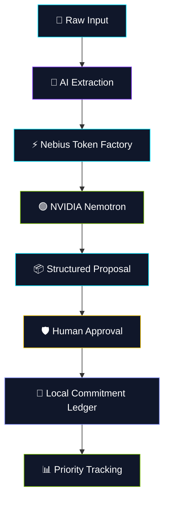

<div align="center">


<br>


<br><br>


<br><br>

<a href="https://nebius-nvidia-hackathon-seven.vercel.app">

</a>

<a href="https://github.com/Raj-max-pixal/PromiseOs">

</a>

<br><br>

**Your commitments, not another chatbot.**

*An AI-powered commitment ledger that turns scattered information into actionable responsibilities.*

</div>

---

<div align="center">

## 🌌 THE PROMISEOS EXPERIENCE


<br>

### From forgotten promises to verified commitments.

</div>

> Replace the decorative GIF above with a recording of your actual application for the strongest hackathon presentation.

---

## 🧠 WHAT IS PROMISEOS?

PromiseOS is a privacy-conscious AI commitment management platform designed to extract actionable responsibilities from notes, conversations, and unstructured text.

Instead of merely responding to prompts, PromiseOS focuses on identifying commitments, preserving their context, and helping users track their progress.

<div align="center">

|    🧠 INTELLIGENCE    |     🛡️ CONTROL     |        ⚡ EXECUTION       |
| :-------------------: | :-----------------: | :----------------------: |
| AI-powered extraction |    Human approval   |    Commitment tracking   |
|  Structured proposals | Source verification |    Deadline awareness    |
|  Context preservation | Local-first records | Action-oriented workflow |

</div>

---

## 🎬 01 — ANIMATED PRODUCT SHOWCASE

<div align="center">

### 💻 Application Demo


*Recommended: Record a 15–20-second walkthrough of the real application.*

<br>

### 🧠 AI Extraction Engine


Convert natural language into structured commitments.

<br>

### 🛡️ Human Approval Workflow


Review AI-generated proposals before accepting them into the ledger.

<br>

### 📊 Daily Priority Dashboard


Surface important responsibilities and upcoming deadlines.

</div>

---

## ⚡ 02 — THE AI PIPELINE

<div align="center">


</div>



---

## 🔄 03 — COMMITMENT LIFECYCLE

<div align="center">


<br>

| STAGE | ACTION                                |
| :---: | ------------------------------------- |
|   01  | 📝 Capture unstructured information   |
|   02  | 🧠 Extract tasks and relevant details |
|   03  | 🔍 Review the supporting evidence     |
|   04  | 🛡️ Approve or edit the proposal      |
|   05  | 📒 Track the commitment               |

</div>

---

## 🎨 04 — FEATURE ANIMATION GALLERY

<div align="center">

<table>
<tr>
<td align="center" width="50%">

### 🔍 AI EXTRACTION


Natural-language processing and structured proposals.

</td>
<td align="center" width="50%">

### 🛡️ HUMAN APPROVAL


User-controlled acceptance of AI suggestions.

</td>
</tr>

<tr>
<td align="center" width="50%">

### 📅 DEADLINE MANAGEMENT


Visualize upcoming responsibilities.

</td>
<td align="center" width="50%">

### 🔄 RECURRING TASKS


Organize repeated commitments.

</td>
</tr>

<tr>
<td align="center" width="50%">

### 👥 TEAM COLLABORATION


Explore delegation and shared accountability workflows.

</td>
<td align="center" width="50%">

### 🤖 AGENT AUTOMATION


Illustrate the planned autonomous follow-up workflow.

</td>
</tr>
</table>

</div>

**Important:** The local GIFs above are placeholders for your actual screen recordings. Use only the feature demonstrations that match your implementation.

---

## 🏗️ 05 — TECHNOLOGY STACK

<div align="center">


<br><br>


</div>

| Component | Technology             | Responsibility                  |
| --------- | ---------------------- | ------------------------------- |
| Frontend  | HTML, CSS, JavaScript  | Interface and user interactions |
| Backend   | Node.js                | API proxy and request handling  |
| Inference | Nebius Token Factory   | Hosted model inference          |
| AI Model  | NVIDIA Nemotron        | Natural-language extraction     |
| Storage   | Browser `localStorage` | Local commitment persistence    |
| Hosting   | Vercel                 | Hosted web application          |

---

## 🔐 06 — PRIVACY & SECURITY

<div align="center">


</div>

* 🔑 Keep API keys out of frontend code and Git commits.
* 📒 Store supported commitment records locally in the browser.
* 🛡️ Allow users to review extracted proposals.
* 🔍 Preserve source excerpts when supported.
* 🚫 Avoid unnecessary logging of sensitive user input.

**Security note:** Browser local storage is not encrypted by default. Information submitted to a hosted AI provider is transmitted outside the browser.

---

## 🚀 07 — QUICK START

```bash
git clone https://github.com/Raj-max-pixal/PromiseOs.git
cd PromiseOs
npm install
npm start
```

Open:

```text
http://localhost:3000
```

Configure the inference API key using the application's supported settings or the backend's environment configuration.

---

## 🗺️ 08 — PROJECT ROADMAP

<div align="center">


</div>

* [x] Core commitment interface
* [x] AI extraction integration
* [x] Human approval workflow
* [x] Browser-based commitment ledger
* [x] Backend inference proxy
* [ ] Production-grade calendar synchronization
* [ ] Robust team collaboration
* [ ] Reliable background agent execution
* [ ] Auditable automated follow-ups
* [ ] Enhanced security and synchronization

Update these checkboxes to reflect verified implementation status.

---

## 💡 09 — WHY PROMISEOS?

<div align="center">


</div>

Traditional chatbots focus on generating responses. PromiseOS focuses on turning information into commitments that users can review and track.

Its core workflow combines:

* **Extraction:** Identify potential commitments.
* **Verification:** Preserve evidence and let users review the result.
* **Approval:** Keep users in control.
* **Tracking:** Organize approved commitments for follow-through.

---

## 🤝 10 — CONTRIBUTING

Contributions and feedback are welcome!

1. Fork the repository.
2. Create a feature branch.
3. Implement and test your changes.
4. Submit a pull request.

## 📄 LICENSE

Released under the MIT License. See [`LICENSE`](LICENSE).

---

<div align="center">


<br><br>

**Built by Raj for the Nebius x NVIDIA Global AI Hackathon.**

[🌐 Live Demo](https://nebius-nvidia-hackathon-seven.vercel.app) · [💻 GitHub Repository](https://github.com/Raj-max-pixal/PromiseOs)


</div>
